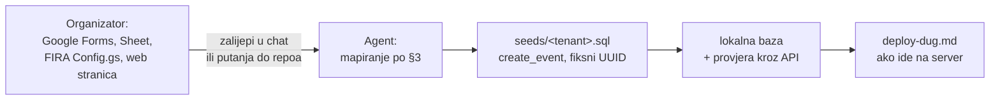

# 2026-09-28 — Događaj se unosi kroz chat, ne kroz editor

> Odluka vlasnika nakon demonstracije Tomislavu Belaviću (Prilika za Susret),
> 26.–28. 9. 2026. Vezani dokumenti: [05 — Podatkovni model](05-podatkovni-model.md),
> [plan do produkcije §5](2026-09-03-plan-do-produkcije.md),
> [seeds/README](../seeds/README.md), [deploy dug](deploy-dug.md).

## 1. Odluka

**Editor događaja (dio U3) je odgođen.** Organizator ne mora prilagođavati
svoj način rada našem obrascu. Događaj pripremi kako već radi, a agent ga u
chatu **formalizira u našu shemu** (`pinka_finance.create_event` preko seeda).

Zašto:

- **Format izrade događaja nije determinističan.** Prilika za Susret događaj
  opisuje kroz Google Forms, Sheet s ručno dodanim stupcima i FIRA `Config.gs`.
  Cijene su tamo u komentaru, a rokovi u rečenici („rana do 15. 10.“). Idući
  tenant radit će drugačije. Editor bi taj šum samo prebacio na organizatora.
- **Postojeći tok je Tomislavu sasvim u redu.** Promjena navike nije cilj proizvoda.
- **Prevođenje iz slobodnog oblika u shemu upravo je posao za agenta.** Uz
  pravila iz §3 rezultat je ponovljiv, iako ulaz nije.

Posljedica za roadmap: U3 „organizator bez ijednog SQL-a“ ([06](06-faze-roadmap.md))
nije uvjet za prve tenante. SQL ne piše organizator, piše ga agent.

## 2. Tok

1. Organizator pošalje što ima: link na formu, izvoz Sheeta, `Config.gs` ili
   tekst sa svoje stranice. Za PzS je izvor istine
   `~/git/stepanic/fira-forms-connector/google-apps-script/events/<slug>/Config.gs`,
   jer se iz njega izdaju pravi računi.
2. Agent napiše ili dopuni blok u `seeds/<tenant>.sql`: jedan `create_event`
   po događaju, fiksni UUID, a u komentaru izvor i commit iz kojeg su podaci.
3. Lokalno se pušta **samo novi blok**, ne cijeli seed, jer prošli događaji
   iz istog seeda zatrpaju katalog. Provjera ide kroz API:
   `GET /api/dogadjaj/<slug>` mora imati `kupovno: true` i očekivane
   `buyable` / `not_started` po tieru.
4. Ako događaj ide na server, dobiva redak u [deploy-dug.md](deploy-dug.md).

## 3. Pravila mapiranja

| Ulaz (kako ga organizator piše) | U shemi | Primjer (Varaždin) |
| --- | --- | --- |
| cijena „50 €“ | `price_cents` kao cijeli broj, nikad float | `5000` |
| „rana do 15. 10.“ | `sale_end` = kraj tog dana **u zoni događaja** | `2026-10-15T23:59:59+02` |
| „redovna nakon 15. 10.“ | `sale_start` = početak idućeg dana | `2026-10-16T00:00:00+02` |
| „prijave do 6. 11.“ | `sale_end` zadnjeg tiera. Pazi na pomak ljetnog računanja vremena: studeni je `+01` | `2026-11-06T23:59:59+01` |
| „na dan susreta 60 €, gotovinom“ | **nije tier**, jer se ne prodaje online; ide samo u `p_description_hr` | — |
| „ograničen broj mjesta“ bez broja | `inventory_total` = `NULL`. Nikad izmišljen broj, inače se kupcu prikazuje lažno „još N mjesta“ | `NULL` |
| mjesto bez adrese | `p_venue_address` = `NULL`. Kad je potpuno nepoznato: `p_venue_name` = „Mjesto održavanja još nije objavljeno“ | `Pastoralni centar`, adresa `NULL` |
| satnica nije objavljena | vrijeme `00:00` u zoni događaja (konvencija: prikazuje se samo datum) | — |
| prijava je osobna (ime u formi) | `"imenska": true` | `true` |
| uvjet povrata | u opis tiera i u opis događaja, doslovno kako je organizator napisao | „Povrat moguć do 2. 11.“ |
| partner ili suorganizator | u `p_description_hr`, ne u `organizer_name` | Obiteljski centar Varaždinske biskupije |

Opće pravilo je [ne izmišljaj](../seeds/README.md): praznina ostaje vidljiva.
Iznosi posuđeni s drugog događaja (Zagreb 2027. ← Šibenik 2026.) moraju to
napisati u opisu događaja.

## 4. Zamke

- **`create_event` je idempotentan po `p_id`, a ne ažurira.** Drugi run vraća
  `existing: true` i **ništa ne mijenja**. Ispravak seeda zato ne mijenja događaj
  koji već postoji u bazi. Postojeći se mijenja kroz `events-organizer`
  `action: "update"` ili se lokalno obriše i napravi ponovno. Varaždin je 26. 9.
  prošao samo zato što `…0f04` lokalno još nije postojao.
- **Vremenska zona po datumu, ne po događaju.** Rok u listopadu je `+02`, a u
  studenom `+01`, iako je isti događaj u istom gradu.
- **Stupci u Sheetu nisu standardni.** Varaždin ima `Uplate`, a ne `Uplata`, i
  headere s razmakom na kraju. To pogađa FIRA konektor, ne ovu shemu, ali znači
  da se ni za ulaz ne može pretpostaviti fiksan oblik. Postupak je u
  `fira-forms-connector/google-apps-script/README.md`, „Adding a new event“.
- **Stripe rail u seedu je izmišljen** (`acct_1PrilikaZaSusret…`, Safe `0x1111…`).
  Događaj je kupiv samo protiv lokalnog lažnog Stripea. Na produkciju ne ide dok
  tenant ne završi pravi onboarding (v. [deploy-dug](deploy-dug.md), „Namjerno se ne deploya“).

## 5. Otvoreno

- **Uvoz već postojećih prijava iz Google Formsa** (ljudi koji su se prijavili i
  platili mimo ove aplikacije). Traži proširenje constrainta `payment_rail`
  (danas samo `onchain`/`stripe`) u `domovina-api`. Isti obrazac „agent
  formalizira“ vrijedi i tu.
- **Kad se editor vraća:** kad tenanata bude toliko da unos kroz chat postane
  usko grlo, ili kad tenant želi sam mijenjati događaj nakon objave. Backend
  postoji (`events-organizer`: `create`, `update`, `publish`), fali samo sučelje.
- **TODO poslan Tomislavu 26. 9.** (WhatsApp): Stripe račun udruge, Monerium/Safe
  adresa, potvrda cjenika za Zagreb 2027., kapacitet, FIRA ključ, tko skenira na
  ulazu. Dok to ne stigne, PzS događaji ostaju lokalni.
