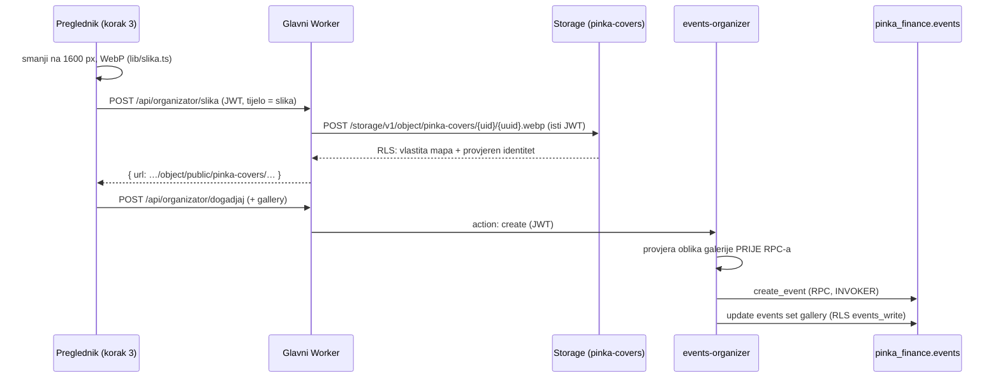

# Upload slika i galerija u editoru događaja (2026-11-24)

Ivanov zahtjev: u `/organizator/novi` naslovna slika **upload ili URL**, i **galerija**
(upload ili URL). **Bez alt teksta** (Ivan: „ne treba nam ni za A ni za B”). Paket izvan lanca `web/`; odluke 819–822 u `web/docs/decisions.md`,
`ui-feedback.md` stavka 8, `deploy-dug.md` #15.

## Tok

## Što je gdje

| Dio | Mjesto |
| --- | --- |
| Smanjivanje u pregledniku | `web/src/lib/slika.ts` (+ `web/test/slika.test.ts`) |
| Upload ruta | `worker/index.ts` `POST /api/organizator/slika`, `worker/api.ts` `ucitajSliku` |
| Polja forme, validacija, payload | `web/src/lib/editor.ts` (`galerija: string[]`), `web/src/lib/nacrt.ts` |
| UI | `web/src/components/NoviDogadjaj.tsx` `Korak3`, `GumbZaDatoteke` |
| Jezgra | `domovina-api` grana `events-media`: `events-organizer` + migracija `20261120170000_events_gallery` |

## Kodovi grešaka

Worker: `nema_prava_slike` (403, RLS Storagea: nema provjeren identitet), `slika_vrsta`
(415), `slika_prevelika` (413), `slika_nije_spremljena` (502), `invalid_gallery` (400,
prije mreže). Jezgra: `invalid_gallery`, `invalid_gallery_url`. Svi
vode na korak 3.

## Lokalna provjera

Stack kao u `docs/2026-08-04-…` §9, ali shim funkcija s granom jezgre:
`FN_ROOT=../domovina-api-media/supabase/functions` (worktree grane `events-media`).

- Upload s provjerenim računom → 200, objekt u `storage.objects`; bez provjerenog
  identiteta → 403 `nema_prava_slike`; nevaljan JWT → 401.
- 6016 px JPEG od 10 MB kroz `DOM.setFileInputFiles` → WebP od 203 kB.
- `events-organizer` create s galerijom je upiše (poslani `alt` i `cover_image_alt` se
  ignoriraju); update zamjenjuje galeriju; update bez nje je ne dira; `http://` i 21
  slika → 400.

**Zamka:** lokalno Storage vraća `http://127.0.0.1:55390/…`, a korak 3 i jezgra traže
`https://`, pa se lokalno učitana slika ne može spremiti u skicu. Na stagingu je URL
`https://api.domovina.ai/…`.

## Dopuna: uredi i obriši skicu (isti dan)

Odluke 823–824, `deploy-dug` #16. Ista grana jezgre (`events-media`): migracija
`20261124170000_events_delete_draft` i `events-organizer` akcija `delete` + `remove_tier_ids`
u `update`. Worker: `GET`/`PUT`/`DELETE /api/organizator/dogadjaj/:id`. Wizard:
`/organizator/novi?uredi=<id>` (`UcitajSkicu`, `unosIzSkice`, `zahtjevIzmjene`).

## Otvoreno

- `events-media` je mergean (PR #6), ali nije deployan: migracije prije `events-feed` i `events-organizer`.
  Bez nove funkcije skica se sprema, ali bez galerije.
- Provjeriti da `pinka-covers` postoji na produkcijskoj jezgri.
- Učitane slike koje organizator ukloni ostaju u bucketu (nema brisanja ni čišćenja).
- Stavka 9: filtar osobnih računa (`is_personal`) u izboru organizatora čeka Ivana.

Nastavak: [besplatni i online događaji](2026-11-25-besplatni-i-online-dogadjaji.md).
