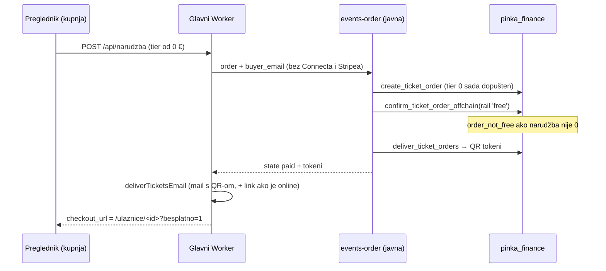

# Besplatni i online događaji (2026-11-25)

Ivanov zahtjev: događaj može biti **komercijalni ili besplatan** i **fizički ili online**.
Odluke 826–827 u `web/docs/decisions.md`, `deploy-dug.md` #18. Jezgra: `domovina-api`
PR #7 (`1564aab`), migracija `20261125120000_events_free_online`.

## Besplatna narudžba

`events-order` je javna funkcija. To je ovdje u redu jer rail `free` sam RPC odbija
za svaku narudžbu koja nije 0 €, pa se kroz nju ne može izdati plaćena ulaznica.

## Link online događaja

`events.attendance_mode` je javan. Link je u `event_access`, a ne u `events`, jer anon
ima `select` na objavljene `events`. Čitaju ga admin računa (editor, RLS) i Worker
service ključem (`api.onlineLink`), samo uz plaćenu narudžbu.

## Zamke koje su koštale vremena

- **`amount_positive` na `contributions`**: check `amount_cents > 0`. Sama izmjena
  `create_ticket_order` nije bila dovoljna, a PostgREST je vraćao samo `{"error":"new"}`
  (početak poruke „new row violates…”). Sada dopušta 0, ali samo uz `tier_id`.
- **Tijela RPC-ova** kopirana su skriptom iz izvornih migracija i promijenjena u redovima
  označenim „2026-11-25”. Komentar na kraju retka u plpgsql-u progutao je `then`, pa
  komentari idu u zaseban red.
- **Worker na jezgri bez migracije**: `GET /api/organizator/dogadjaj/:id` traži
  `attendance_mode` i `event_access(...)`. Bez migracije PostgREST odbija cijeli upit, pa
  postoji rezervni upit bez njih (`546cba8`).
- **Lokalni shim funkcija** treba env iz `supabase status` (`SUPABASE_URL`, ključeve,
  `EVENTS_STRIPE_CONFIRM_SECRET`). Bez njih sve funkcije padaju sa „supabaseUrl is
  required”. Kopija bloka iz `scripts/lokalno/pokreni.sh` s `FN_ROOT` na worktree.
- **Lokalni testni JWT**: izmišljeni `session_id` u JWT-u daje `not_authenticated` (GoTrue
  traži sesiju). Bez `session_id` prolazi.

## Otvoreno

- Deploy jezgre: migracija prije `events-order`, `events-organizer` i `events-feed`.
  Do tada se na stagingu online i besplatno ne spremaju, a besplatna narudžba pada na
  `tier_price_missing`.
- Zaštita od pražnjenja besplatnih mjesta je samo limit po IP-u (`order`).
- Wizard bira komercijalno ili besplatno za cijeli događaj; mješavinu ne nudi, iako je
  jezgra i Worker podržavaju po vrsti ulaznice.

Povezano: [upload slika i galerija](2026-11-24-upload-slika-i-galerija.md),
[deploy dug](deploy-dug.md).
