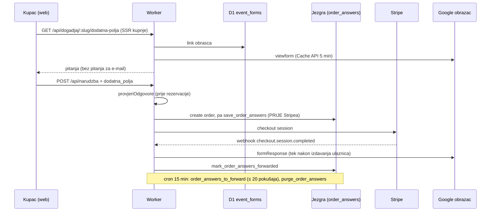

# Dodatna polja kupnje iz Google obrasca (26.–27. 11. 2026.)

Organizator uz događaj zalijepi link na **javni Google obrazac**; kupnja ispod
e-maila prikaže njegova pitanja („Dodatna polja”). Odgovori se spremaju u jezgru
i prosljeđuju u organizatorov obrazac (njegov Google Sheets). Kod:
`worker/dodatna-polja.ts`, `web/src/components/DodatnaPolja.tsx`; jezgra
`domovina-api` migracija `20261126120000_ulaznice_odgovori_kupaca` (PR #9).
Deploy: `docs/deploy-dug.md` #23.

Ovdje je ono što se iz koda ne vidi: kako izgleda obrazac iznutra, što je odbačeno
i zašto, zamke i što je otvoreno.

## Tok

Besplatna narudžba: isto, ali `formResponse` ide odmah nakon izdavanja ulaznica
(`waitUntil`), a pad upisa odgovora ne ruši već izdane ulaznice.

## Kako izgleda javni obrazac iznutra

Provjereno 26. 11. na tri javna obrasca i na Ivanovom testnom. Stranica
`…/viewform` ima `var FB_PUBLIC_LOAD_DATA_ = [...];</script>`:

- `d[1][1]` = stavke; `d[1][8]` naslov obrasca (`d[3]` je naziv datoteke).
- stavka: `[itemId, naslov, opis, tip, [[entryId, opcije, obavezno(1/0), krajeviSkale, …, [uzVrijeme, uzGodinu]]]]`.
- tipovi: 0 tekst, 1 odlomak, 2 izbor, 3 padajući, 4 kvačice, 5 skala, 7 mreža,
  8 odjeljak (nova stranica), 9 datum, 10 vrijeme, 13 upload; 6/11/12 bez odgovora.
- opcija: `[vrijednost, null, idiNaOdjeljak, null, jeLiOstalo]`.
- `d[1][10][6]` je postavka skupljanja e-maila (nije dekodirano; `emailAddress`
  se šalje uvijek, Google višak ignorira).

Slanje: `POST …/formResponse`, `entry.<id>=…` (kvačice ponovljeni ključ, datum
`_year/_month/_day`, vrijeme `_hour/_minute`), `fvv=1`,
`pageHistory=0,1,…` (sve stranice). Uspjeh = 200.

Odgovori Googlea na čitanje: obrazac s prijavom → **401** (`obrazac_trazi_prijavu`),
zatvoren → preusmjeren na `…/closedform` (`obrazac_zatvoren`).

## Odbačeno

| Varijanta | Zašto ne |
|---|---|
| Odgovori samo u Google obrascu, privremeno u D1 dok se ne pošalju (prva verzija, 26. 11.) | Kad Google odbije (organizator zatvori ili promijeni obrazac), nakon 20 pokušaja podaci ostaju zaglavljeni bez roka brisanja; organizator ih ne vidi kod nas. Ivan je odlučio: izvor istine u jezgri |
| JSON stupac na `orders` | Stroži RLS i rok brisanja ne smiju dirati narudžbu i ulaznice; zasebna tablica `order_answers` |
| Link obrasca u jezgri | Prezentacija, ne ticketing; D1 `event_forms` ne čeka deploy jezgre |
| `alter table event_pages add column form_url` | `scripts/lokalno/pokreni.sh` pušta SVE D1 migracije pri svakom startu, a SQLite nema `add column if not exists` → drugi start pada; zato zasebna tablica `create table if not exists` |
| Odgovori po ulaznici | Jedan skup po narudžbi (kupac), kao u obrascu |

## Zamke

- **Ne testirati slanje na tuđim javnim obrascima** — svaki `formResponse` je pravi
  odgovor nekome u tablici. Za čitanje su poslužili javni obrasci iz pretrage, za
  slanje Ivanov testni obrazac.
- Pitanje čiji je naslov „E-mail”/„Email Address” Worker ne prikazuje, nego ga
  puni e-mailom kupca (`EMAIL_NASLOV_RE`).
- Odgovori se spremaju sa **snimkom teksta pitanja** (`{id, pitanje, odgovor}`):
  CSV sudionika ima stupac po tekstu pitanja, pa promjena obrasca ne razbije stare
  odgovore.
- Na stagingu je 27. 11. na `koncert-u-parku-2` povezan stvaran obrazac udruge
  (14 pitanja, uključujući bračni status) — tamo ne kupovati testne ulaznice.

## Otvoreno

- **Politika privatnosti**: platforma sada čuva odgovore kupaca (moguće posebne
  kategorije, čl. 9 GDPR-a — npr. vjera na susretu za katolički brak). Tekst
  `web/src/pages/privatnost.astro` i ugovor o obradi s organizatorom nisu dopunjeni.
- Grananje po odjeljcima se ne prati (kupac vidi sva pitanja); „Ostalo” sa
  slobodnim unosom se ne nudi; upload i mreža ne smiju biti obavezni.
- Kupnja s obrascem na stagingu od kraja do kraja nije isprobana; mail ionako ne
  ide dok nema `RESEND_API_KEY` (deploy-dug #10).
- Produkcija: Workeri i D1 `0003` na `domovina-ulaznice` (deploy-dug #23).

## Povezano

- `docs/deploy-dug.md` #23 (deploy, provjere), #24 (znak u zaglavlju)
- `domovina-api/supabase/tests/20261126_ulaznice_odgovori_kupaca.sql` (25 provjera RLS-a, reda i roka)
