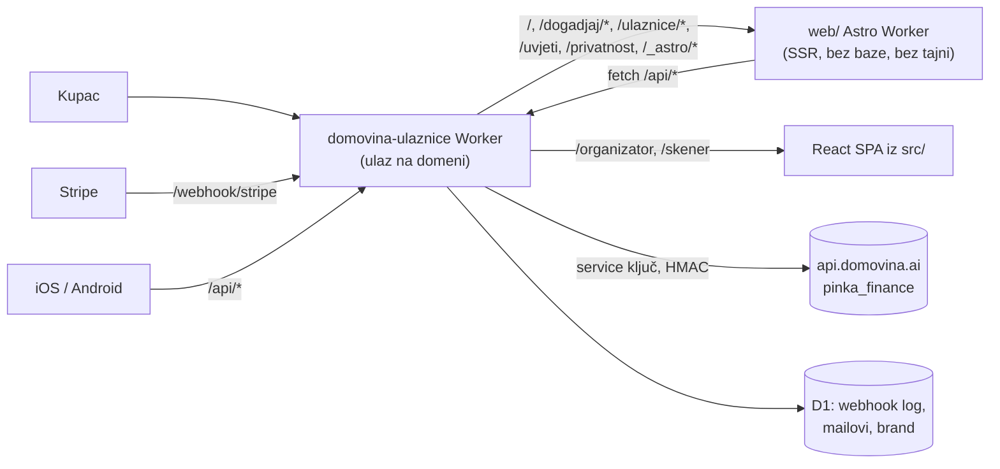

# Plan — Astro frontend za kupce (`web/`)

Napisano 2026-11-19 (S0, Matija Stepanić). Izvodi Ivan Stepanić u forku
`IStep95/domovina-ulaznice`, sesiju po sesiju, s PR-om na `domovinatv/domovina-ulaznice`
nakon svake.

## Zašto

Stranice na kojima kupac gleda događaj i kupuje ulaznicu danas su dio React SPA-a
(`src/`). SPA se iscrtava tek u pregledniku, pa link na događaj podijeljen na
WhatsAppu ili Facebooku nema pravi pregled (naslov, slika), a tražilice stranicu vide
slabo. Za prodaju ulaznica to je glavni kanal. Astro na Cloudflare Workersima iscrta
stranicu na serveru, a interaktivni su samo dijelovi kojima to treba (forma za kupnju).
UI se dizajnira u Claude Designu, pa se dizajn i kod razvijaju odvojeno od backenda.

Organizator, skener i prijava ostaju u postojećem SPA-u: puno interakcije, kamera,
nema SEO-a, i rade.

## Arhitektura



| Dio | Gdje | Što drži |
| --- | --- | --- |
| Astro frontend | `web/` | samo prikaz; podatke dobiva iz `/api/*` |
| Worker (API, webhook, SPA) | `worker/`, `src/` | Stripe, HMAC, service ključ, D1, KV, mailovi |
| Ticketing jezgra | `../domovina-api` | događaji, tierovi, narudžbe, ulaznice |

## Tvrdi uvjeti (vrijede u svakoj sesiji)

1. **`web/` nema bazu ni tajne.** Nema D1, KV ni `wrangler secret`. Ulaznice, narudžbe i
   inventory žive samo u jezgri (pravilo 1 u korijenskom `CLAUDE.md`).
2. **`web/` nikad ne zove `api.domovina.ai`.** Sve ide kroz `/api/*` postojećeg Workera,
   kao i mobilne aplikacije. Samo taj Worker smije držati Stripe ključeve, HMAC tajnu i
   service ključ (pravila 3 i 4).
3. **Ugovor `/api/*` se mijenja samo u S2b, aditivno** (nova nullable polja događaja,
   odluka 21). Inače se ne mijenja. Ako stranici treba nešto novo, to je
   zaseban, mali commit na `worker/` s testom, a `mobile/mock-api.mjs` se ažurira u istom
   commitu.
4. **Novac u cijelim centima**, formatira se tek za prikaz.
5. **Prodaja na produkciji nije dio lanca.** `ulaznice.domovina.ai` ostaje najava
   (`NAJAVA=1`), a `ulaznice-web.domovina.ai` ne smije izgledati kao prodaja (odluka 24).
   Staging `web/` se deploya sam na merge; sve ostalo deploya Matija.

## Korak 0 (gotovo 2026-11-19, Matija)

| Okruženje | Worker | Domena | Deploy | API |
| --- | --- | --- | --- | --- |
| staging | `domovina-ulaznice-web-staging` | `ulaznice-web-staging.domovina.ai` | Workers Builds, merge u `main` | `ulaznice-staging.domovina.ai` |
| produkcija | `domovina-ulaznice-web` | `ulaznice-web.domovina.ai` | ručno, Matija | `ulaznice.domovina.ai` (najava, `/api` 404) |
| lokalno | `astro dev` / `wrangler dev` | `localhost:4321` | — | `mobile/mock-api.mjs` (8797) |

Oba Workera serviraju `web/privremeno/` dok S1 ne uvede Astro (odluke 22–24). Test
događaj za staging je pripremljen u `seeds/staging-web-pregled.sql` i čeka Matiju.

## Sesije

| # | Faza | Paket | Odluke | Gotovo kad |
| --- | --- | --- | --- | --- |
| S1 | F0 | Astro kostur, zajednički tipovi, dev protiv mocka, mjerenje SSR-a na Workersu, design brief | 100 | `npm --prefix web run check` zelen; `curl` stranice događaja iz `wrangler dev` sadrži naslov u `<title>` i `og:title`; `npm test` i `npm run build` u korijenu zeleni |
| — | vrata | (!) Ivan napravi dizajn u Claude Designu po `web/docs/design-brief.md` | — | export u `web/design/` commitan |
| S2 | F1 | dizajnerski sustav: tokeni, layout, komponente | 200 | svaka komponenta iz exporta ima Astro ili React parnjaka; `check` zelen; snimke na 390 px i 1280 px u `docs/research/` |
| S2b | F1 | dorada sheme događaja: `venue_lat`, `venue_lon`, `cover_image_alt` (migracija u `domovina-api`, `events-feed`, Worker, tipovi, mock) | 250 | migracija idempotentna (drugi run no-op); `GET /api/dogadjaj/:slug` u mocku i lokalno vraća nova polja; korijenski `npm test` zelen |
| — | vrata | (!) Matija primijeni migraciju i deploya `events-feed` | — | `api.domovina.ai` vraća nova polja |
| S3 | F1 | popis i događaj (SSR, OG, JSON-LD s `geo`, karta, Markdown opis, „dodaj u kalendar”, stanja tierova) | 300 | testovi za novac, datum i stanja tierova; `curl` na mock vraća OG i JSON-LD za oba događaja |
| S4 | F1 | kupnja (React otok, `POST /api/narudzba`, greške) | 400 | kupnja kroz mock završi na `/ulaznice/:id?placeno=1`; svaki kod greške iz `worker/api.ts` ima poruku i test |
| S5 | F1 | narudžba, pravne stranice, 404 | 500 | pending → paid kroz mock; ponovna dostava i preuzimanje rade; pravne stranice prerenderirane (`dist/` sadrži HTML) |
| S6 | F2 | service binding u Workeru, lokalna e2e kupnja, `deploy-dug.md` | 600 | test podjele putanja u `worker-tests/`; cijela kupnja lokalno (`scripts/lokalno/pokreni.sh`) prolazi kroz Astro; `npm test` zelen |
| — | vrata | (!) Matija deploya oba Workera na staging | — | `ulaznice-staging.domovina.ai/dogadjaj/<slug>` dolazi iz Astra |
| S7 | F2 | mjerenje na stagingu, uklanjanje kupačkih stranica iz `src/`, dokumentacija | 700 | Lighthouse brojke u `docs/research/`; `src/pages/` bez kupačkih stranica; `npm run build`, `npm test`, `check` zeleni |

Procjena: **8 sesija**, troja vrata (dizajn, migracija jezgre, staging deploy). S2b ne
mora čekati dizajn (može ići odmah nakon S1, paralelno s Ivanovim radom u Claude
Designu); S3 ne čeka migraciju jer su nova polja nullable. Ostalo je redom: S3–S5
dijele layout i API klijent, a S6 i S7 ovise o svemu prije.

Prijedlog sheme iz Ivanove bilješke (2026-11-19): od deset stavki tri traže promjenu
(koordinate, alt naslovne slike), dvije su gotove u shemi, dvije su odgođene (galerija,
`city_id`), dvije odbijene (tagovi, „tko dolazi”), a Markdown opis i kalendar ne traže
shemu. Detalji: odluke 14–21.

Najrizičniji paketi:

- **S1**: mjeri radi li Astro SSR s `@astrojs/cloudflare` u našem `wrangler`u i
  kompatibilnosnom datumu. Ako ne radi, plan se mijenja prije nego što se dizajnira.
- **S6**: podjela putanja na istoj domeni. Odluka 8 je service binding; S6 je mora
  potvrditi lokalno. Povratak sa Stripe Checkouta (`/ulaznice/:id`), linkovi iz maila i
  `/.well-known/*` za mobilne aplikacije ne smiju puknuti.

## Kako Ivan radi u forku

```bash
git clone git@github.com:IStep95/domovina-ulaznice.git && cd domovina-ulaznice
git remote add upstream git@github.com:domovinatv/domovina-ulaznice.git
# prije svake sesije
git fetch upstream && git merge --ff-only upstream/main
# na kraju svake sesije (wrap-up)
git push origin main
gh pr create --repo domovinatv/domovina-ulaznice --head IStep95:main --title "web: SN …"
```

Matija prati kroz remote `ivan` u svom klonu (`git fetch ivan && git log origin/main..ivan/main`)
i merga PR. Sljedeća sesija kreće tek kad je prethodni PR mergean, da fork i upstream ne
odu svaki na svoju stranu.

## Gdje smo

S0 (2026-11-19): plan, odluke i handoffi napisani; dopunjeno Ivanovim prijedlogom sheme (S2b).
Korak 0 (2026-11-19): oba Workera živa sa stranicom „u izradi”, staging na Workers Buildsu. Koda u `web/` nema. Sljedeće: S1.
